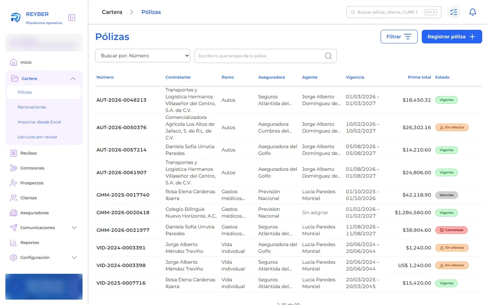
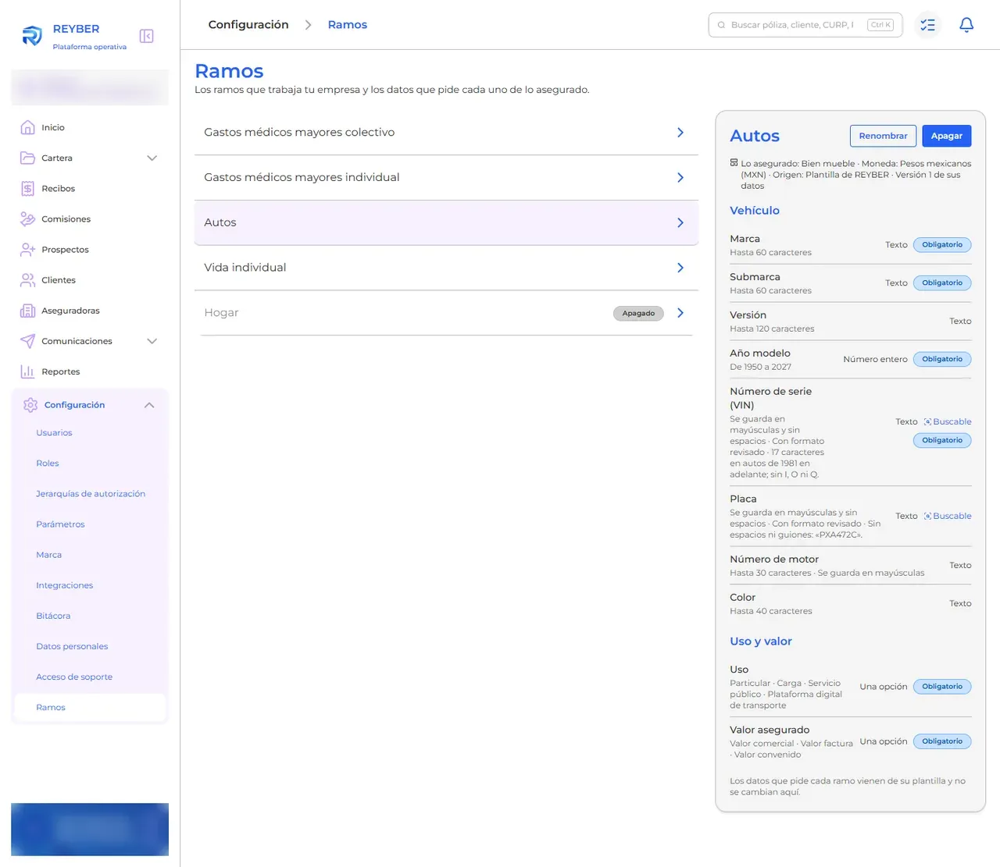
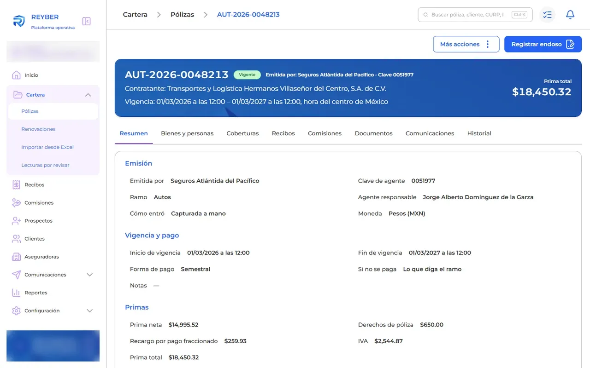

# REYBER — dynamic insurance attributes at 10M policies

## The real product

*Real product, demo tenant with fictional data.*







> Public mini-demo with fictional data. The full product is private; access on request: carrerabernal@gmail.com

## Live demo

https://carrerable.github.io/reyber-dynamic-attributes-demo/

## What it demonstrates

- Three fictional product lines (auto, pet, boat) whose risk attributes are declared as data: key, bilingual label, type, required, searchable and options.
- A form and a Zod validator generated from that schema, with number coercion and list parsing.
- The storage decision derived from the schema: searchable scalar attributes go to a plain column, searchable list attributes to a projection table, the rest stay in JSONB only.
- A "Benchmark R1" panel with four bars comparing the hybrid design with a projection table for everything. Figures were measured on 2026-09-22 on 10M synthetic policies with RLS enabled, in the real project's prototype; they are static here.

## What is fictional and what is real

Product lines, attributes and form values are fictional. The four benchmark figures are real measurements of the private prototype (labelled in the page). The code is written from scratch; no code of the real product is included.

## Run locally

```bash
npm ci && npm run dev
```

Add `?lang=es` for Spanish.

## Tests

```bash
npm test
```

## How it was built

Code written with Claude Code under my specs and code review; I designed the behavior, wrote the acceptance tests and verified the result.

## Case study

https://carrerable.github.io/en/projects/reyber/

## License

MIT
